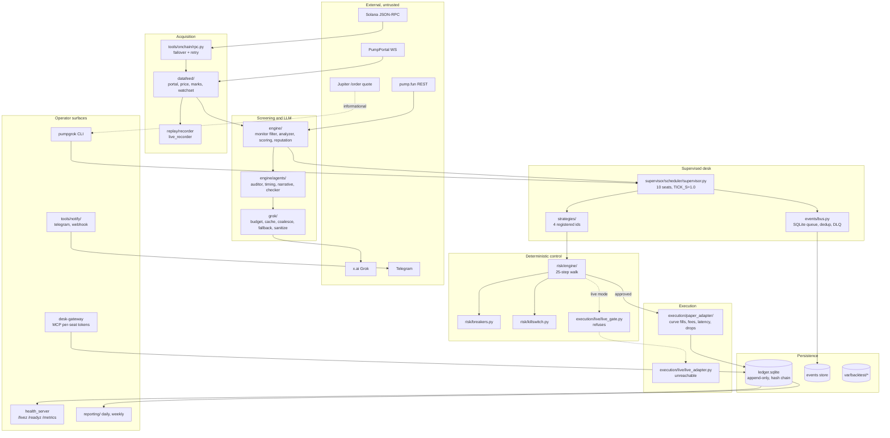
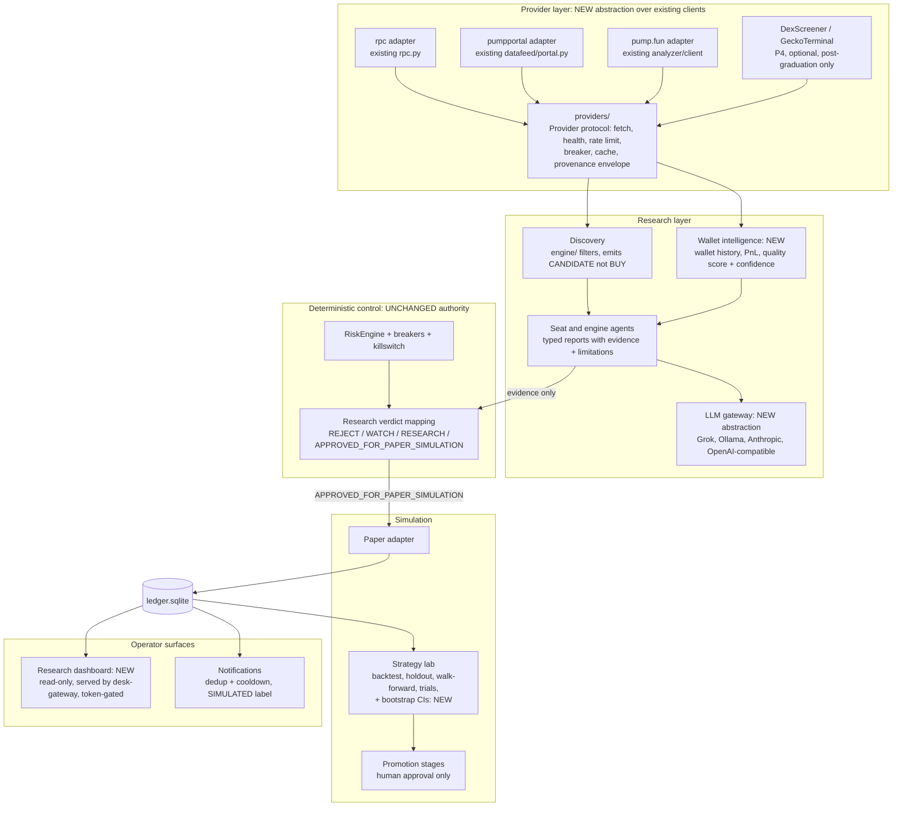

# Architecture (runtime view)

The root [`ARCHITECTURE.md`](../ARCHITECTURE.md) describes the instruction pack (agents,
skills, rules, plugin manifests). This file describes the Python runtime in
`src/pumpgrok/` as it exists at `7dc5db3`, then the proposed target. Evidence for every
box is in [REPOSITORY_AUDIT.md](REPOSITORY_AUDIT.md).

## 1. Current architecture

Notes on the diagram:

- `run --mode paper --once --replay <dir>` and `run --serve --replay <dir>` drive the
  supervisor on a `FixtureClock`. `run --live-paper` composes the live datafeed into a
  paper desk (`supervisor/live_paper.py`) but currently places nothing (`_no_place`).
- The live adapter exists but every path to it passes `LiveGate`, and `run --mode live`
  exits 3.
- `events/sources.py` (backoff, staleness, cursors) is not wired into the supervisor.
- `services/desk-gateway/src/desk_gateway/console.py` is not routed; there is no UI.

### Layer rules already enforced

| Rule | Enforced by |
|------|-------------|
| Only risk-approved orders reach a fill path | `risk/engine/core.py`; `supervisor/intent_router.py` is the only placement path in live-paper |
| Model output is data | `grok/sanitize.py` `parse_strict_json`; pydantic parsing in `engine/agents/base.py` |
| Time is injected | `replay/clock.py` `Clock`; no wall-clock defaults |
| Money is integer lamports, ratios `Decimal` | `core/units.py`, `core/risk_budget.py` |
| Each file has one owning seat | `ownership.yaml`, `ci/gates/check_ownership.py` |
| Ledger cannot be edited | SQLite triggers in `ledger/store.py` |

## 2. Proposed architecture

The target keeps every box above. It adds four components and wires one existing one.
Nothing new may bypass the deterministic gate.

### Design constraints for the target

1. Agents produce evidence. `VER` is computed from `RiskEngine` output plus deterministic
   thresholds; an agent verdict can lower a verdict, never raise one past risk.
2. The provider envelope records source, observed time, retrieved time, subject id,
   quality, confidence, and one of `realtime | delayed | inferred | unavailable`.
   Missing data stays `unavailable`; it is never filled.
3. The dashboard is read-only. Any future control (kill switch, breaker reset) goes
   through the existing CLI verbs and their refusal rules, behind a confirmation.
4. The LLM gateway preserves the existing budget, cache, coalesce, and fallback modules;
   it adds a provider field, not a second budget system.
5. SQLite stays. No new database technology is justified by any measurement so far.

See [ROADMAP.md](ROADMAP.md) for sequencing and [DECISIONS.md](DECISIONS.md) for the
recorded choices.
