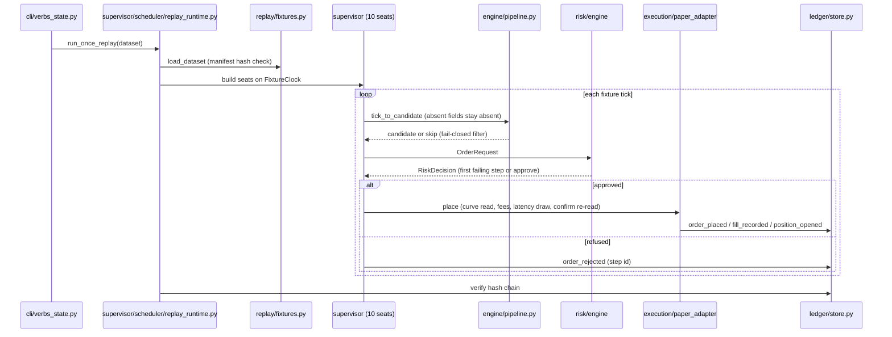
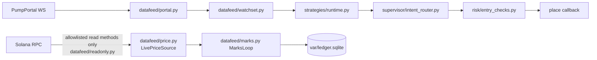

# Data flow

How a datum travels from an external source to a ledger row, for the three run forms that
exist today. Paths are relative to `src/pumpgrok/`.

## 1. Replay cycle (`run --mode paper --once --replay <dir>`)

Ledger output: `var/replay/<dataset>/ledger.sqlite`, `source=replay`.

## 2. Live-data paper (`run --mode paper --live-paper`)

Today `place` is `_no_place` in `cli/verbs_state.py`. Without `--serve` the desk is composed,
then the command returns. With `--serve` (P0-2b, `supervisor/live_paper_loop.py`) the
PumpPortal transport (`datafeed/portal_ws.py`) feeds `PortalFeed` through `run_feed`; feed
events are counted and reported on `/healthz`, not traded. A source with no transport yields stale, never invented, ticks
(`datafeed/fallback.py`).

Event-mode source wiring (P1-5, `events/feed_link.py`): a datafeed adapter reports to a
`FeedLink`, which updates both the `SourceSupervisor` (backoff, staleness, held-mint
cursor) and the risk engine's `FeedHealth`. `run_feed(link, connect, ...)` reads frames,
records a gap on disconnect, resyncs held mints, waits the supervisor's backoff on the
injected clock and reconnects; unknown errors propagate. `build_event_desk` builds the
`pumpportal` link and `EventDesk.source_states()` returns the shape `doctor` prints. In paper
mode a stale required feed degrades the verdict; only live mode blocks entries (RSK-03).

## 3. Operator reads (`pumpgrok tools <id>`)

Each tool resolves through the registry (`tools/__init__.py`), validates input against its
schema, performs one read (RPC or ledger), and prints `{"ok": true|false, ...}` JSON. Errors
never include endpoint URLs or header values (`tools/onchain/rpc.py`).

## 4. Provenance carried today

| Field | Where it exists |
|-------|-----------------|
| Source | ledger `events.source` (`paper`, `replay`, `manual`); tool `meta` blocks (`tools/_common.py` `meta_now`) |
| Observed time | fixture tick `ts_utc`; ledger `ts_utc` |
| Freshness | `core/datasource.py` `Freshness`; `risk/feed_health.py`; `DataStaleBreaker` |
| Correlation | `events.correlation_id`; `core/correlation.py` |
| Signal identity | `signal_id` on `OrderRequest` / `exec.place` and on `FillRecorded` / `OrderRejected`: idempotency key of a `signal` JournalNote holding an `AgentReport` (`engine/report.py`, P1-4b) |
| Dataset identity | sealed manifest hash (`backtest/manifest.py`, `replay/fixtures.py`); on each replay `FillRecorded` / CONFIRMING `OrderRejected` as `dataset_id` = `dataset_digest` (P1-4b) |
| Retrieval time, observed time, subject, quality | Tool `meta` (`core/tool.py` `ToolMeta`): `fetched_at`, `observed_at` (ledger reads only; `None` when the source does not report it), `subject` (from the input `mint` / `creator` / `ticket_id`), `quality` (`ledger`, `onchain`, `onchain_assumed`, `simulated`, `derived`, `local`; declared on each `ToolSpec`). Availability: `meta.stale` on an output, `DataStale` / `DataBlind` when unavailable (ROADMAP P1-2) |
| Confidence per datum | Not on raw data. Belongs to analysis outputs (wallet scores, P2-1) |
| Datafeed ticks | `curve_source`, `mint`, `ts_utc` (receive time) already present; on-chain observed time (slot / blockTime) not yet carried (P1-2b) |

## 5. Trust boundaries

Everything from section "External" in [ARCHITECTURE.md](ARCHITECTURE.md) is untrusted:
RPC responses, WS frames, token name/symbol/description/URI, and model output. The
boundaries that validate it are pydantic models at ingress (`engine/models.py`,
`events/models.py`), strict JSON parsing of model output (`grok/sanitize.py`), and the
read-method allowlist (`datafeed/readonly.py`). Token text reaches LLM prompts as JSON
fields; it never reaches a shell, a file path, or a URL.
