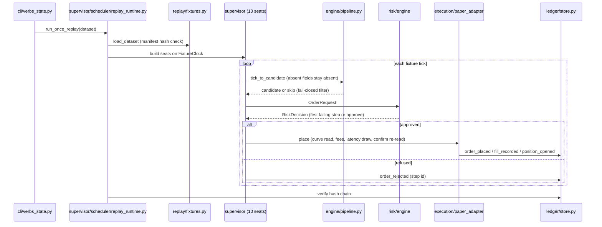
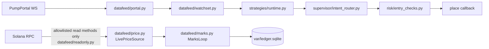

# Data flow

How a datum travels from an external source to a ledger row, for the three run forms that
exist today. Paths are relative to `src/pumpgrok/`.

## 1. Replay cycle (`run --mode paper --once --replay <dir>`)

Ledger output: `var/replay/<dataset>/ledger.sqlite`, `source=replay`.

## 2. Live-data paper (`run --mode paper --live-paper`)

Today `place` is `_no_place` in `cli/verbs_state.py`: the desk is composed, then the command
returns. A source with no transport yields stale, never invented, ticks
(`datafeed/fallback.py`).

## 3. Operator reads (`pumpgrok tools <id>`)

Each tool resolves through the registry (`tools/__init__.py`), validates input against its
schema, performs one read (RPC or ledger), and prints `{"ok": true|false, ...}` JSON. Errors
never include endpoint URLs or header values (`tools/onchain/rpc.py`).

## 4. Provenance carried today

| Field | Where it exists |
|-------|-----------------|
| Source | ledger `events.source` (`paper`, `replay`, `manual`); tool `meta` blocks (`tools/_common.py` `meta_now`) |
| Observed time | fixture tick `ts_utc`; ledger `ts_utc` |
| Freshness | `core/datasource.py` `Freshness`; `risk/feed_health.py`; `DataStaleBreaker` |
| Correlation | `events.correlation_id`; `core/correlation.py` |
| Dataset identity | sealed manifest hash (`backtest/manifest.py`, `replay/fixtures.py`) |
| Retrieval time, quality, confidence per datum | Not uniform. Planned as the provider envelope (ROADMAP P1-2) |

## 5. Trust boundaries

Everything from section "External" in [ARCHITECTURE.md](ARCHITECTURE.md) is untrusted:
RPC responses, WS frames, token name/symbol/description/URI, and model output. The
boundaries that validate it are pydantic models at ingress (`engine/models.py`,
`events/models.py`), strict JSON parsing of model output (`grok/sanitize.py`), and the
read-method allowlist (`datafeed/readonly.py`). Token text reaches LLM prompts as JSON
fields; it never reaches a shell, a file path, or a URL.
