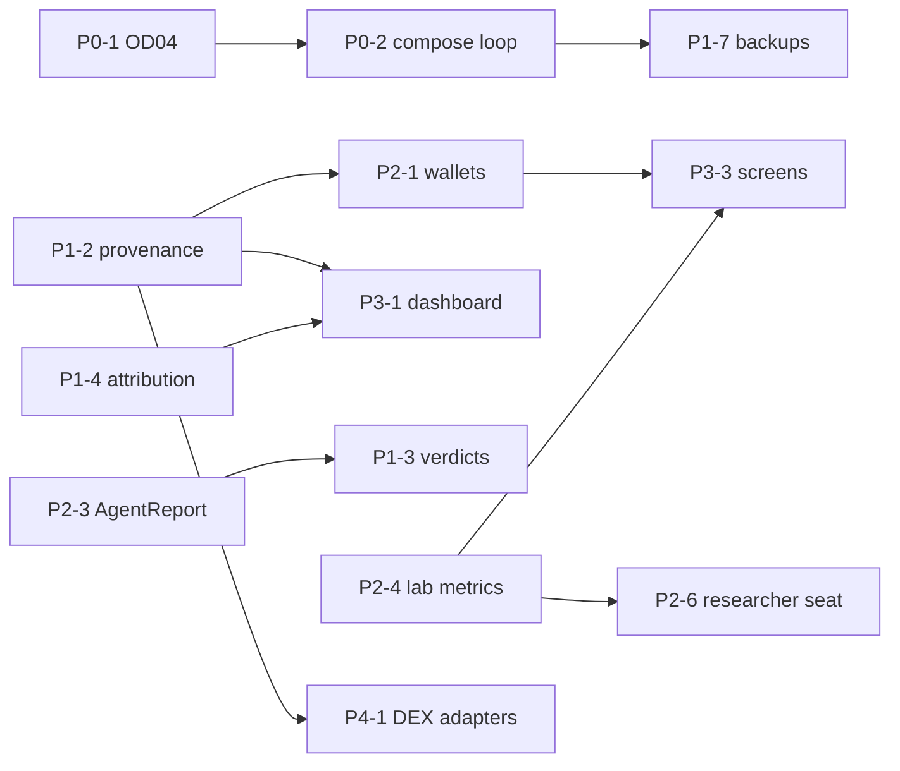

# Roadmap

Product roadmap derived from [REPOSITORY_AUDIT.md](REPOSITORY_AUDIT.md). The GSD execution
roadmap with phase plans is `.planning/ROADMAP.md`; items here become GSD phases when
scheduled. Complexity: S (under a day), M (1-3 days), L (a week or more). "Approval" means
the change touches safety posture, money math, or credentials and needs the owner's explicit
yes before implementation.

## P0: security, correctness, stability

| ID | Item | Files | Size | Depends on | Approval | Acceptance |
|----|------|-------|------|------------|----------|------------|
| P0-1 | Remove `PUMPGROK_OD04_PROBE_REVIEW: "approved"` from compose; document setting it in the secret env file after review | `docker-compose.yml`, `docs/OPERATIONS.md` | S | none | Yes | compose default service refuses live-paper until the operator sets the flag |
| P0-2 | Make the default compose service long-running: either point it at `--serve --replay` or give `--live-paper` a loop that binds the health port | `docker-compose.yml` or `cli/verbs_state.py`, `supervisor/live_paper.py` | S (compose) / M (loop) | P0-1 | Yes | healthcheck passes; no restart loop |
| P0-3 | Commit or drop the untracked WIP: fix ruff findings in four scripts; implement `CurveRiseTracker` or remove `tests/engine/test_momentum_gate.py` | `scripts/*.py`, `src/pumpgrok/engine/pipeline.py` | S-M | owner's intent | No | `make check` green on a clean clone |
| P0-4 | Decide large fixtures (`live-06/07/08`, 1.1 GB total): git-ignore, move under `var/recordings/`, or LFS | `.gitignore` | S | none | Owner choice | no fixture over 10 MB tracked without LFS |
| P0-5 | Remove duplicated stale lines from `README.md`, `ARCHITECTURE.md`, `CLAUDE.md` | those files | S | none | No | each statement appears once and matches code |
| P0-6 | `.env` permission check in `pumpgrok doctor` (warn on group/world bits) | `src/pumpgrok/doctor.py` | S | none | No | doctor prints a warning for mode 664; test covers it |

## P1: data quality, reliability, paper realism

| ID | Item | Files | Size | Depends on |
|----|------|-------|------|------------|
| P1-1 | Confirm the curve layout with `scripts/probe_curve_layout.py`; drop `[ASSUMED]` | `tools/onchain/curve_layout.py` | S (needs RPC access: approval for credentials if a paid RPC is used) | none |
| P1-2 | **Done (tool meta), 2026-11-26.** `ToolMeta` carries `observed_at`, `subject`, `quality` next to `source` / `fetched_at` / `stale`; every production `ToolSpec` declares `quality` (test enforced) and the `tool()` wrapper stamps it. Availability is `stale` or a `DataStale` / `DataBlind` raise. Not done: `confidence` (belongs to P2-1 analysis outputs, D-011) and on-chain observed time on datafeed ticks (P1-2b: needs slot / blockTime from the feed; changes event-mode golden hashes) | `core/tool.py`, `tools/**` specs | M | none |
| P1-3 | **Done (risk-only), 2026-11-26.** Deterministic research-verdict mapping (REJECT / WATCH / RESEARCH / APPROVED_FOR_PAPER_SIMULATION); agents can only lower it. `risk/verdict.py`; surfaced by `risk.check_limits`. Open: feeding agent recommendations needs P2-3 | `risk/verdict.py`, `tools/risk/check_limits.py` | M | P2-3 for agent input |
| P1-4 | **Partly done, 2026-11-26.** `assumptions_json` (fee model and params, latency distribution, drop probability, partial-fill cap, price basis, curve-layout status) on every `FillRecorded` and CONFIRMING `OrderRejected` row. Open: `signal_id` and `dataset_id` (P1-4b; `OrderRequest` is `extra="forbid"` with many callers, so it needs its own change; `decision_id` and `correlation_id` already link fill to decision and cycle) | `execution/assumptions.py`, `execution/paper_adapter/*.py`, `ledger/events.py`, `contracts/events/*.schema.json` | M | none |
| P1-5 | Wire `events/sources.py` (backoff, staleness, cursors) into the event-mode supervisor | `supervisor/event_desk.py` | M | none |
| P1-6 | Calibrate REVIEW fee/latency constants against recorded live data; record the calibration dataset id | `execution/fees.py`, `execution/latency.py`, `scripts/measure_replay.py` | M | recorded data (in progress) |
| P1-7 | Scheduled ledger backup (host cron or compose sidecar) | `docs/OPERATIONS.md`, compose | S | P0-2 |

## P2: agents, wallet intelligence, strategy research

| ID | Item | Files | Size | Depends on |
|----|------|-------|------|------------|
| P2-1 | Wallet intelligence module: per-wallet history from RPC signatures, realized PnL where reconstructable, hold time, win rate, data completeness, quality score with confidence; explicit "insufficient history" state | new `src/pumpgrok/wallets/`, `tools/onchain/*` reuse, tests | L | P1-2 |
| P2-2 | Untrusted-content hardening for engine prompts: system-prompt clause, length caps on token text | `engine/agents/*.py` | S | none (changes request hash: re-record smoke LLM fixtures) |
| P2-3 | `AgentReport` envelope (see [AGENT_CATALOG.md](AGENT_CATALOG.md) section 4) emitted via `journal.append`; record agent disagreements as a journal note kind | `engine/models.py`, `tools/journal/append.py` | M | none |
| P2-4 | Strategy lab: bootstrap CIs, expectancy, Sortino, median return, avg win/loss; sensitivity report over the declared param space | `backtest/metrics_v2.py`, `backtest/report.py` | M | none |
| P2-5 | LLM provider abstraction (Grok, Ollama, OpenAI-compatible, Anthropic) behind the existing budget/cache/fallback; per-agent model selection; token and latency tracking per call | `core/llm.py`, `engine/agents/base.py`, `config/sections/core.py` | M-L | none |
| P2-6 | STRATEGY_RESEARCHER seat with read-only roster (backtest results, ledger reads) | `ownership.yaml`, `agents/`, `contracts/tool-rosters/` | M | P2-4 |

## P3: dashboard, notifications, UX

| ID | Item | Size | Depends on |
|----|------|------|------------|
| P3-1 | Read-only research dashboard served by desk-gateway behind the existing bearer auth: overview, candidates, positions, journal, system health. Server-rendered, no external assets, every number labeled SIMULATED and stamped with freshness. Reuse `console.py` primitives | L | P1-2, P1-4 |
| P3-2 | Notification policy: per-kind enable flags, cooldowns beyond the per-minute idempotency key, daily summary; every message prefixed `[PAPER]` | M | none |
| P3-3 | Wallet and strategy-lab screens | M | P2-1, P2-4 |

## P4: optional integrations

| ID | Item | Notes |
|----|------|-------|
| P4-1 | DexScreener / GeckoTerminal adapters for post-graduation tokens | only after P1-2; free tiers have tight rate limits |
| P4-2 | RugCheck adapter as a second opinion, never a sole gate | external verdict is evidence |
| P4-3 | Social sources | only with lawful API access |
| P4-4 | `services/desk-signer` boundary for any future execution | separate process, separate review; live stays refused until then |

## Dependency graph

## Implemented in this increment

Increment 3 (branch `bot-00-chief/p1-2-provenance`):

- P1-2 done for tool meta: provenance fields on `ToolMeta`, `quality` on all 37 production
  tool specs, stamping in `core/tool.py`; datafeed observed time deferred as P1-2b.

Increment 2 (branch `bot-00-chief/p1-attribution-verdicts`):

- P1-3 done (risk-only): `src/pumpgrok/risk/verdict.py`, wired into `risk.check_limits`.
- P1-4 partly done: execution assumptions on fills and CONFIRMING rejections; trading-smoke
  pin re-pinned (CHANGELOG before/after lines; drift proven to be the new field only).

Increment 1:

- P0-1, P0-2 done (compose option): default `pumpgrok` serves the replay loop; live-paper
  root is opt-in profile `live-paper`, no restart, OD-04 flag from the operator shell. A
  long-running live-paper loop remains open (P0-2b, M, needs approval).
- P0-4 done: `live-06/07/08` git-ignored.
- P0-6 done: `pumpgrok doctor` secret-file permission warning.
- P0-7 done: Docker secret `/run/secrets/pumpgrok_env` is now loaded into the process env
  by both entry points (SECURITY_AUDIT S-03).

- Nine docs in `docs/` from the audit (this file and its siblings).
- P0-5 done: stale duplicate lines removed from `README.md`, `ARCHITECTURE.md` (root), and
  `CLAUDE.md`; `CLAUDE.md` now states that `run --record` and `run --live-paper` exist. No
  runtime change. `scripts/check.sh` and the 12 doc-referencing test modules pass.
